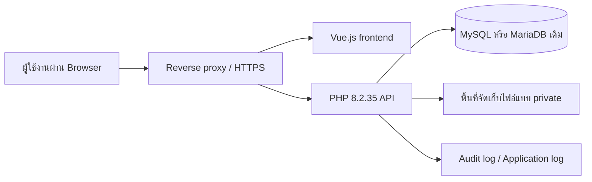

> สถานะเอกสาร ณ 15 พฤศจิกายน 2026: เนื้อหาด้านล่างเป็นข้อกำหนดและแผนออกแบบย้อนหลังของระบบเดิม ปัจจุบันใช้ Node.js/Express/TypeScript + Vue 3 วิธีติดตั้งและสถานะการใช้งานให้อ้างอิง [README.md](README.md), [DEPLOYMENT_GUIDE.md](DEPLOYMENT_GUIDE.md) และ [BACKUP_GUIDE.md](BACKUP_GUIDE.md) ข้อเสนอในเอกสารนี้ไม่ได้หมายความว่าพัฒนาและตรวจรับครบแล้ว
# แผนพัฒนาระบบ DOCZ ด้วย PHP 8.2.35 และ Vue.js

วันที่จัดทำ: 20 ตุลาคม 2026 (Asia/Bangkok)  
ปรับปรุง: 27 ตุลาคม 2026 (Asia/Bangkok) — เปลี่ยนเป้าหมาย backend เป็น PHP 8.2.35 ตามคำขอล่าสุด  
สถานะ: แผนก่อนพัฒนา อ้างอิงผลสำรวจฐานข้อมูลที่บันทึกไว้เดิม ยังไม่ได้ตรวจฐานข้อมูลซ้ำหรือยืนยัน compatibility ของแอป

ผลตรวจไฟล์และ runtime รอบนี้: `PHP_8_2_READINESS.md` (เอกสารเดิม ไม่ได้รวมอยู่ในชุดปัจจุบัน; ใช้ README สำหรับการติดตั้งปัจจุบัน)

รายละเอียดเพิ่มเติมจากข้อกำหนดการลงรับหนังสือ: [โครงสร้างโปรแกรมและโมดูลลงรับหนังสือ](./PROGRAM_STRUCTURE.md) ครอบคลุมสิทธิ์เจ้าหน้าที่ การรันเลขรับ หนังสือนำ PDF และเอกสารแนบหลายไฟล์ ให้ใช้อ้างอิงร่วมกับแผนฉบับนี้

ข้อกำหนด workflow ที่ยืนยันเพิ่มเติม: [เกษียนหนังสือและแจกจ่ายเพื่อปฏิบัติ](./ENDORSEMENT_WORKFLOW.md) ใช้สองเส้นทาง หัวหน้างาน → ผู้อำนวยการ และหัวหน้างาน → ผู้อำนวยการ → ผู้บริหารสูงสุด เมื่อครบขั้นส่งกลับเจ้าหน้าที่ผู้รับหนังสือเพื่อแจกจ่ายให้สมาชิกทุกคนหรือผู้เกี่ยวข้อง รายละเอียดนี้มีผลแทนร่างเส้นทางทั่วไปและประเด็นลำดับหลักที่เคยรอยืนยันในแผนฉบับนี้ ส่วนการมอบอำนาจ ถอนเรื่อง และการปิดงานยังต้องกำหนดเพิ่มเติม

## 1. เป้าหมายและขอบเขตการสำรวจ

รายละเอียดเมนูผู้ดูแลที่ได้รับเพิ่มเติมจากภาพ: [ADMIN_STRUCTURE.md](./ADMIN_STRUCTURE.md) ครอบคลุม User, กำหนดสิทธิ์, กำหนดขั้นตอน และกำหนดแฟ้มเอกสาร

พัฒนาเว็บแอปพลิเคชันใหม่ โดยใช้ PHP 8.2.35 เป็น backend และ Vue.js เป็น frontend พร้อมรักษาข้อมูลเอกสาร ผู้ใช้ สิทธิ์ และไฟล์แนบเดิม เพื่อเปลี่ยนผ่านจากระบบเก่าได้อย่างตรวจสอบย้อนกลับได้

แหล่งข้อมูลที่เอกสารเดิมบันทึกว่าตรวจอ่านเมื่อ 20 ตุลาคม 2026 (รอบนี้ไม่ได้เชื่อมฐานข้อมูลซ้ำ):

- [โครงสร้างฐานข้อมูล docz](http://localhost:8099/phpmyadmin/index.php?route=/database/structure&db=docz)
- [Data dictionary ของ docz](http://localhost:8099/phpmyadmin/index.php?route=/database/data-dictionary&db=docz)
- พื้นที่ `C:\project\docz` ยังไม่พบไฟล์แอปพลิเคชันหรือข้อกำหนดโครงการ ณ เวลาสำรวจ

ผลสำรวจเดิมระบุ 17 ตาราง ใช้ InnoDB และหน้าโครงสร้างแสดง collation เป็น `utf8mb4_general_ci` การจัดทำแผนนี้อ่านเฉพาะ metadata ไม่ได้อ่านรายการผู้ใช้หรือเนื้อหาเอกสาร และไม่ได้แก้ไขฐานข้อมูล

จากชื่อและคอลัมน์ คาดว่าเป็นระบบจัดการหนังสือ/เอกสารและการส่งต่อภายในองค์กร แต่ยังต้องยืนยันกับผู้ใช้งานจริง ไม่สามารถสรุปกระบวนงานหรือความหมายรหัสสถานะจาก schema เพียงอย่างเดียวได้

## 2. ตารางที่ตรวจพบและการแบ่งโมดูล

จำนวนแถวด้านล่างเป็นค่าประมาณที่ phpMyAdmin แสดง ไม่ใช่ผล `COUNT(*)` และอาจเปลี่ยนแปลงระหว่างการสำรวจ จึงห้ามใช้เป็นยอดตรวจรับการย้ายข้อมูล

| ตาราง | แถวประมาณ | หน้าที่ที่คาดจากโครงสร้าง |
| --- | ---: | --- |
| `docz` | 18,664 | ข้อมูลหลักเอกสาร เลขรับ วันที่ เรื่อง ผู้สร้าง และสถานะ |
| `doc_cat` | 18,691 | เชื่อมเอกสารกับหมวดหมู่ |
| `doc_cat_name` | 398 | รายการหมวดหมู่ |
| `doc_file` | 3,969 | ข้อมูลไฟล์แนบและผู้เพิ่มไฟล์ |
| `doc_manage` | 46,530 | การมอบหมาย/ส่งต่อ ลำดับ ผู้รับ และรายละเอียดการดำเนินการ |
| `doc_profile` | 3 | ชุดรูปแบบเอกสารหรือเส้นทางดำเนินงาน ต้องยืนยัน |
| `doc_profile_sub` | 7 | รายการย่อยของรูปแบบและลำดับบทบาท ต้องยืนยัน |
| `doc_user_read` | 83,430 | การอ่าน/รับทราบและปักหมุดรายผู้ใช้ |
| `migration` | 10 | ประวัติ migration ของระบบเดิม |
| `profile_pfname` | 3 | คำนำหน้าชื่อ |
| `role` | 42 | การผูกผู้ใช้กับบทบาทและข้อมูลหน่วยงาน |
| `role_name` | 12 | รายชื่อบทบาท |
| `role_power` | 20 | สิทธิ์หรืออำนาจเพิ่มเติมตามผู้ใช้/บทบาท ต้องยืนยัน |
| `user` | 71 | บัญชีผู้ใช้และข้อมูลยืนยันตัวตน |
| `user_dep_name` | 20 | หน่วยงาน |
| `user_group_work` | 8 | กลุ่มงาน |
| `user_profile` | 71 | ประวัติผู้ใช้ สังกัด รูปภาพ และภาพลายเซ็น |

### 2.1 ความสัมพันธ์ที่ต้องตรวจสอบ

รายการต่อไปนี้เป็นความสัมพันธ์ที่อนุมานจากชื่อคอลัมน์ ไม่ใช่การยืนยันว่ามี foreign key บังคับอยู่จริง:

- `doc_cat.doc_id` → `docz.id`; `doc_cat.doc_cat_name_id` → `doc_cat_name.id`
- `doc_file.docz_id` → `docz.id`; `doc_file.user_id_create` → `user.id`
- `doc_manage.doc_id` → `docz.id`; `user_id` → `user.id`; `role_name_id` → `role_name.id`
- `doc_user_read.doc_id` → `docz.id`; `user_id` → `user.id`
- `docz.user_create` → `user.id`; `user_profile.user_id` → `user.id`
- `role` และ `role_power` เชื่อม `user.id` กับ `role_name.id` แต่กฎการให้สิทธิ์ต้องยืนยัน
- `doc_profile_sub.doc_profile_id` เป็น `varchar(255)` ขณะที่ `doc_profile.id` เป็น `int(11)` จึงยังห้ามเชื่อมด้วยสมมติฐานว่าเป็นเลข ID
- `user_profile.dep_name`, `group_work`, `pfname`, `role` เป็นข้อความ ยังสรุปไม่ได้ว่าเก็บชื่อ รหัส หรือเลข ID ในรูปข้อความ

## 3. สถาปัตยกรรมที่เสนอ

เริ่มด้วย backend เดียวที่แบ่งเป็นโมดูล และ frontend เดียว เพื่อลดภาระการดูแลและทำ transaction ของเอกสารกับการส่งต่อได้สะดวก

| ส่วน | เทคโนโลยีที่เสนอ | เหตุผล/เงื่อนไข |
| --- | --- | --- |
| Runtime | PHP 8.2.35 | ยืนยัน CLI และ web SAPI แยกกัน พร้อมทดสอบบนรุ่นนี้จริง |
| Backend | PHP แบ่งโมดูล + Composer / PSR-4 | เลือก framework หลังตรวจ source เดิมและ dependency ที่รองรับ 8.2.35; ไม่อนุมาน framework จาก schema |
| Database access | PDO MySQL หรือ ORM ของ framework ที่ผ่านการตรวจ | map ชื่อตาราง/คอลัมน์เดิม ใช้ prepared statements และ transaction บน InnoDB |
| Database | ใช้ MySQL/MariaDB เดิมในระยะแรก | ตรวจชนิดและเวอร์ชัน server จริงก่อนกำหนด driver; หน้าเว็บ phpMyAdmin ไม่ใช่ตัวฐานข้อมูล |
| Frontend | Vue 3 + TypeScript + Vite | ใช้ `create-vue` เป็นจุดเริ่มต้นและล็อก dependencies |
| Navigation/state | Vue Router + Pinia | แบ่งหน้าและจัดการ session/state ที่ต้องใช้ร่วมกัน |
| UI | เลือก component library หนึ่งชุดในช่วงต้นแบบ | ทดลองตารางค้นหา ฟอร์มภาษาไทย และการใช้งานบนมือถือก่อนตัดสินใจ |
| API | REST `/api/v1` + OpenAPI | กำหนด request, response และข้อผิดพลาดร่วมกัน |
| Authentication | Session ฝั่ง server + cookie `HttpOnly` | frontend/API ใช้ origin เดียวกัน; กำหนด CSRF และอายุ session |
| Files | Private filesystem ผ่าน storage adapter | เปลี่ยนเป็น object storage ได้ในอนาคตเมื่อมีความต้องการ |
| Deployment | Apache หรือ Nginx + PHP SAPI ที่เหมาะกับ OS + Vue static build | กำหนด document root เฉพาะ public; เลือก mod_php/FastCGI/PHP-FPM ตามเครื่องจริง |

ข้อกำหนดตั้งต้น:

- frontend ติดต่อผ่าน API เท่านั้น ไม่เชื่อมฐานข้อมูลโดยตรง
- PHP เชื่อม SQL host/port ด้วยบัญชีแอปที่มีสิทธิ์เท่าที่จำเป็น; `8099` เป็น HTTP port ของ phpMyAdmin ไม่ใช่ SQL port ที่ยืนยันแล้ว
- ไม่ใช้ ORM auto schema update และไม่รัน migration ขณะ boot/request ทุก environment; schema เปลี่ยนผ่าน migration ที่ตรวจทานและสั่งรันโดยขั้นตอน release
- map legacy entities โดยไม่สร้าง foreign key, unique constraint หรือเปลี่ยนชนิดข้อมูลอัตโนมัติ
- ช่วงสำรวจใช้ฐานข้อมูลสำเนาและบัญชี read-only; แยก development, test, staging, production
- ยังไม่เพิ่ม Redis, queue, microservices หรือ realtime จนกว่าจะมีปัญหาที่วัดได้หรือข้อกำหนดชัดเจน

## 4. ขอบเขตรุ่นแรก (MVP)

### 4.1 ผู้ใช้และสิทธิ์

- เข้าสู่ระบบ ออกจากระบบ ตรวจสถานะบัญชี และจัดการ session
- แสดง/แก้ไขข้อมูลส่วนตัวตามสิทธิ์ รวมถึงรูปภาพ
- ผู้ดูแลจัดการบัญชี บทบาท หน่วยงาน และกลุ่มงาน
- ตรวจสิทธิ์ทั้งระดับการกระทำและระดับเอกสารใน API ทุกเส้นทาง รวมถึงดาวน์โหลดไฟล์และรายงาน
- ร่างบทบาทเชิงการใช้งาน: ผู้ดูแล เจ้าหน้าที่ทะเบียน ผู้รับดำเนินการ และผู้ดู/ผู้บริหาร ต้อง map กับ `role_name` จริงก่อนใช้
- ตรวจว่า `role_power` เป็นสิทธิ์เสริม การมอบอำนาจ หรือความสัมพันธ์แบบอื่นก่อนออกแบบ permission matrix

### 4.2 เอกสารและไฟล์แนบ

- ค้นหา/แบ่งหน้า/เรียงลำดับตามเลขรับ เรื่อง วันที่ หมวดหมู่ และสถานะ
- สร้างเอกสาร ดูรายละเอียด แก้ไข และยกเลิกตามกฎสิทธิ์ที่ยืนยัน
- รองรับข้อมูลเดิม เช่น `r_number`, `r_date`, `doc_form_number`, `doc_date`, `doc_form`, `doc_to`, `doc_speed`, `name`
- กำหนดกฎออกเลขรับ รวมถึงรอบปีและความซ้ำ ก่อนสร้างเลขอัตโนมัติ
- ผูกหมวดหมู่หลายรายการได้ หากยืนยันว่า `doc_cat` ใช้งานแบบหลายต่อหลาย
- อัปโหลด/ดาวน์โหลดไฟล์ พร้อมตรวจชนิด ขนาด ชื่อไฟล์ และสิทธิ์
- สำรวจ `docz.file` และ `doc_file.file` ว่าเป็นไฟล์หลัก/ไฟล์แนบหรือข้อมูลซ้ำก่อนออกแบบหน้าจอ

### 4.3 การดำเนินงานเอกสาร

- กล่องงานของฉัน รายการที่รับผิดชอบ ส่งต่อ และประวัติการดำเนินงาน
- กำหนดผู้รับ บทบาท ลำดับ ข้อความประกอบ และสถานะผ่าน transaction
- บันทึกอ่าน/รับทราบและปักหมุดตามความหมายที่ยืนยันของ `doc_user_read.check` และ `pin`
- รองรับรูปแบบจาก `doc_profile`/`doc_profile_sub` หลังยืนยันหน้าที่จริง
- ร่างสถานะเพื่อหารือ: สร้าง → ลงทะเบียน → ส่งต่อ → ดำเนินการ → เสร็จสิ้น/ยกเลิก; ห้ามถือว่าเท่ากับรหัส `st` เดิม
- จัดทำตาราง transition ระบุสถานะต้นทาง ปลายทาง ผู้มีสิทธิ์ ข้อมูลบังคับ และผลต่อรายการผู้รับก่อนเขียน workflow

### 4.4 ภาพรวมและรายงาน

- สรุปเอกสารตามช่วงเวลา สถานะ และหน่วยงาน ภายใต้ขอบเขตสิทธิ์เดียวกับรายการเอกสาร
- รายงานงานค้างเมื่อกำหนดเกณฑ์กำหนดส่งและความหมาย `start`/`end` ได้แล้ว
- ส่งออกรายงาน CSV และพิจารณา Excel/PDF ตามแบบที่ผู้ใช้งานยืนยัน
- Audit log สำหรับเข้าสู่ระบบ เปลี่ยนข้อมูลเอกสาร ส่งต่อ เปลี่ยนสิทธิ์ และดาวน์โหลดไฟล์

### 4.5 งานหลัง MVP

การแจ้งเตือนภายนอก เช่น LINE/อีเมล, OCR, full-text search ขั้นสูง, SSO, ลายเซ็นดิจิทัล และแอปมือถือ ให้ประเมินแยกหลังรุ่นแรก ภาพ `sign_photo` เดิมไม่เพียงพอยืนยันว่ามีระบบลายเซ็นดิจิทัล

## 5. แผนฐานข้อมูลและข้อมูลเดิม

### 5.1 สำรวจและสร้าง baseline

1. ยืนยัน SQL host/port, server version, timezone, SQL mode, charset และสิทธิ์บัญชีแอป
2. เก็บ schema export ที่ครอบคลุม indexes, constraints, triggers, views, routines และ events แล้วทบทวน dependencies ของระบบเก่า
3. สร้างฐานข้อมูลสำเนาและสำรองไฟล์จริง ทดลอง restore ก่อนเริ่มงานเขียนข้อมูล
4. ตรวจจำนวนจริง ข้อมูลซ้ำ ค่า NULL และ orphan references บนสำเนา จัดทำรายงาน baseline
5. สำรวจที่เก็บไฟล์ รูปภาพ และลายเซ็น ตรวจไฟล์หาย path สัมพัทธ์/สัมบูรณ์ และสิทธิ์ filesystem
6. จัดทำ data dictionary เพิ่มความหมายรหัส `st`, `ty`, `check`, `doc_form`, `doc_speed` และกฎของแต่ละช่อง

### 5.2 ความเสี่ยงที่พบจาก schema

| ประเด็น | แนวทางดำเนินการ |
| --- | --- |
| คอลัมน์เชื่อมข้อมูลส่วนใหญ่แสดงเฉพาะ primary index ใน Data dictionary | ตรวจ indexes จริงและ `EXPLAIN` ก่อนเพิ่ม composite index |
| ชื่อเชื่อมไม่สม่ำเสมอ เช่น `doc_id`/`docz_id`, `user_create`/`user_id_create` | ใช้ entity mapping และ API DTO ที่สม่ำเสมอ โดยรักษาชื่อเดิมในฐานข้อมูลช่วงแรก |
| `doc_profile_sub.doc_profile_id` เป็นข้อความ | ตรวจค่าจริงและกฎเดิมก่อนแปลงชนิดหรือสร้างความสัมพันธ์ |
| `created_at` ของ `user` เป็น int แต่หลายตารางใช้ timestamp/datetime | ยืนยันหน่วย epoch และ timezone; กำหนด API เป็น ISO 8601 หลังแปลงตามกฎที่ทดสอบแล้ว |
| `user_profile` เก็บสังกัด/บทบาทเป็นข้อความ | ทำ mapping ตรวจค่าที่จับคู่ไม่ได้ แล้วค่อยพิจารณาปรับโครงสร้าง |
| เอกสารมีไฟล์ทั้งใน `docz` และ `doc_file` | จัดทำ manifest ของทั้งสองแหล่งและกติกาแสดงผลไฟล์เก่า |
| มี `password_hash` แต่ยังไม่ทราบ algorithm | ทดสอบด้วยบัญชีทดสอบที่ได้รับอนุญาต; รองรับ verify เดิมแล้ว rehash หรือกำหนด reset password |
| ตาราง `migration` ของระบบเดิม | แยกตารางประวัติ migration ใหม่ เช่น `docz_php_migrations` ไม่ปะปนรายการเดิม |

### 5.3 การเปลี่ยน schema ที่เสนอให้ประเมิน

- เพิ่ม indexes ตาม query จริง เช่น `doc_cat(doc_id)`, `doc_file(docz_id)`, `doc_manage(user_id, st, doc_id)` และ `doc_user_read(user_id, doc_id)` โดยตรวจแผน query และดัชนีซ้ำก่อน
- พิจารณา index วันที่และสถานะใน `docz` ตามรูปแบบค้นหาที่วัดแล้ว; การค้นหา `%ข้อความ%` ต้องประเมินแยกจาก B-tree index ปกติ
- กำหนด unique `(user_id, doc_id)` ใน `doc_user_read` เฉพาะเมื่อยืนยันว่าหนึ่งคู่ต้องมีเพียงหนึ่งรายการและจัดการข้อมูลซ้ำแล้ว
- อย่ากำหนด `r_number` ให้ unique เดี่ยวจนกว่าจะทราบว่าต้องแยกปี ประเภท หรือหน่วยงานหรือไม่
- เพิ่มตาราง `audit_logs` และ `app_sessions` ด้วย migration ใหม่ โดยออกแบบ retention และสิทธิ์เข้าถึง
- foreign key และการ normalize ให้ทำเป็นงานแยกหลังตรวจข้อมูลและ compatibility กับระบบเก่า
- ใช้การเปลี่ยนแปลงแบบเพิ่มก่อน หลีกเลี่ยงลบ/เปลี่ยนชื่อคอลัมน์ที่ระบบเก่ายังใช้อยู่

## 6. โครงสร้างโปรเจกต์ที่เสนอ

เป็นโครงสร้างเชิงแนวคิด ยังไม่สร้างไฟล์แอป และอาจปรับตาม framework ที่ตรวจผ่านในระยะ 0

~~~text
docz/
  apps/
    api/
      composer.json
      composer.lock
      public/index.php
      src/
        Modules/
          Auth/
          Authorization/
          Users/
          IncomingLetters/
          ReceiveNumbering/
          DocumentFiles/
          Endorsement/
          Distribution/
          Inbox/
          Admin/
          MasterData/
          Reports/
          Audit/
        Infrastructure/
          Database/
          Storage/
        Shared/
      config/
      routes/
      database/migrations/
      tests/
    web/
      src/
        api/
        components/
        layouts/
        views/
        router/
        stores/
        composables/
      e2e/
  contracts/openapi.yaml
  docs/
    database/
    decisions/
    operations/
  infra/
  scripts/
~~~
Backend ใช้ Composer พร้อม composer.lock; Vue ใช้ package manager และ lockfile ของ frontend โดย Node.js ใช้สำหรับ build frontend เท่านั้น แบ่งปัน API contract ผ่าน OpenAPI และสร้าง TypeScript types ตามต้องการ ไม่ส่ง database entities หรือความลับไป frontend และจัดเก็บไฟล์อัปโหลดไว้นอก source tree/public directory

## 7. API และหน้าจอตั้งต้น

เส้นทางด้านล่างเป็นร่างทั่วไปจากแผนเดิม ไม่ใช่ endpoints ที่พัฒนาแล้ว ก่อนสร้าง OpenAPI ให้ใช้เส้นทางเฉพาะใน PROGRAM_STRUCTURE.md สำหรับลงรับ/ไฟล์, ENDORSEMENT_WORKFLOW.md สำหรับเกษียน/แจกจ่าย และ ADMIN_STRUCTURE.md สำหรับ Admin เป็นหลัก แล้วตัด endpoints ที่ซ้ำออก ไม่สร้าง API สองชุดสำหรับกฎเดียวกัน

| กลุ่ม | API ตัวอย่าง | หน้าจอหลัก |
| --- | --- | --- |
| Session | `POST /api/v1/auth/login`, `POST /api/v1/auth/logout`, `GET /api/v1/auth/me` | เข้าสู่ระบบ/ข้อมูลส่วนตัว |
| เอกสาร | `GET/POST /api/v1/documents`, `GET/PATCH /api/v1/documents/:id` | ค้นหา/สร้าง/รายละเอียดเอกสาร |
| ไฟล์ | `POST /api/v1/documents/:id/attachments`, `GET /api/v1/attachments/:id/download` | ไฟล์แนบ |
| Workflow | `GET /api/v1/tasks`, `POST /api/v1/documents/:id/assignments`, `POST /api/v1/assignments/:id/transitions` | งานของฉัน/ส่งต่อ/ประวัติ |
| การอ่าน | `PUT /api/v1/documents/:id/read-state`, `PUT /api/v1/documents/:id/pin` | อ่าน/รับทราบ/ปักหมุดตามสิทธิ์ |
| ผู้ดูแล | `/api/v1/users`, `/api/v1/roles`, `/api/v1/departments`, `/api/v1/work-groups`, `/api/v1/categories` | ตั้งค่าระบบ |
| รายงาน | `GET /api/v1/reports/documents`, `GET /api/v1/audit-logs` | รายงาน/บันทึกตรวจสอบ |

API contract ต้องระบุ pagination ที่จำกัดขนาดหน้า, allowlist การเรียงลำดับ, validation, รูปแบบ error, เขตเวลา และ status codes เช่น 401/403/404/409 กำหนด conflict handling สำหรับแก้ไขพร้อมกัน และป้องกันการสร้างเอกสาร/ส่งต่อซ้ำจากการกดซ้ำด้วย idempotency หรือข้อบังคับที่เหมาะกับ transaction

## 8. ความปลอดภัยและความถูกต้อง

- ตรวจ permission ใน server ทุกครั้ง ใช้ query ที่จำกัดขอบเขตเอกสารของผู้ใช้ก่อนอ่านหรือแก้ไข
- เก็บ session ฝั่ง server และเพิกถอนได้; cookie ใช้ `Secure` ใน HTTPS และ `SameSite` ที่เหมาะสม พร้อม CSRF protection สำหรับการเขียนข้อมูล
- ไม่คืน `password_hash`, `auth_key`, reset/verification tokens ผ่าน API หรือ application logs
- จำกัดความถี่การเข้าสู่ระบบ ตรวจสถานะบัญชี และไม่ใช้ข้อความ error ที่เผยว่าบัญชีมีอยู่หรือไม่
- ใช้ parameterized queries และตรวจ input; frontend แสดงข้อความโดย escape ตามปกติ
- ไฟล์ใช้ชื่อภายในที่ระบบสร้าง ตรวจเนื้อหา/ชนิดและขนาด ป้องกัน path traversal และห้าม execute ในที่เก็บไฟล์
- ดาวน์โหลดผ่าน API ที่ตรวจสิทธิ์; แสดง inline เฉพาะชนิดที่อนุญาต และใช้ attachment download สำหรับชนิดอื่น
- รูปภาพลายเซ็นและประวัติผู้ใช้ต้องมีขอบเขตเข้าถึงชัดเจน ไม่บันทึกเนื้อหาเหล่านี้ลง log
- บันทึก audit ผู้กระทำ เวลา document ID การกระทำ และ request ID โดยกรองข้อมูลลับ
- การสร้างเอกสารพร้อมหมวดหมู่/ผู้รับใช้ transaction; การเขียนไฟล์ต้องมีขั้นตอน staging และ cleanup เมื่อ transaction ล้มเหลว
- ใช้ UTC สำหรับเวลาใหม่ที่เป็นจุดเวลา และแสดง Asia/Bangkok; แยกวันที่ปฏิทินออกจาก timestamp และไม่แปลงข้อมูลเก่าจนกว่าจะทราบ timezone จริง
- จัดการ secrets ผ่าน environment/ระบบจัดเก็บความลับ พร้อม `.env.example` ที่ไม่มีค่าจริง

## 9. แผนพัฒนาและกำหนดส่งโดยประมาณ

สมมติฐาน: นักพัฒนา 2 คน มีผู้ประสานงานกฎธุรกิจ และผู้ใช้ทดสอบที่ตอบคำถามได้ภายในแต่ละสัปดาห์ ประเมิน MVP 10–12 สัปดาห์หลังได้รับข้อมูลและสิทธิ์ที่จำเป็น หากทำคนเดียวต้องประเมินใหม่ตามกำลังงานจริง ช่วงเวลาเดิมเป็นกรอบ MVP ใหม่ ไม่ใช่ประมาณการแก้ PHP legacy; ต้องประเมินอีกครั้งเมื่อได้ source และต้องจัดงานอัปเกรด runtime ก่อน 31 ธันวาคม 2026 เพราะกรอบ 10–12 สัปดาห์จากปลายตุลาคมอาจข้ามอายุสนับสนุน PHP 8.2

| ระยะ | เวลา | งาน | ผลส่งมอบและเกณฑ์ผ่าน |
| --- | --- | --- | --- |
| 0. สำรวจ | สัปดาห์ 1 | สำรวจระบบเก่า schema ไฟล์ สถานะ และสิทธิ์ | Data dictionary, permission matrix, workflow และขอบเขต MVP ที่ผู้รับผิดชอบยืนยัน |
| 1. วางรากฐาน | สัปดาห์ 2 | ตั้ง workspace, API, Vue, CI, DB clone, session | build ผ่าน เชื่อมสำเนาได้ login/logout ได้ และไม่มี schema sync อัตโนมัติ |
| 2. ผู้ใช้และข้อมูลกลาง | สัปดาห์ 3 | ผู้ใช้ บทบาท หน่วยงาน กลุ่มงาน หมวดหมู่ | ผ่านการทดสอบสิทธิ์ทั้ง API และหน้าจอ |
| 3. เอกสารและไฟล์ | สัปดาห์ 4–5 | ค้นหา สร้าง แก้ไข หมวดหมู่ อัปโหลด และเปิดไฟล์เก่า | เส้นทางงานหลักครบ พร้อมทดสอบไฟล์หายและการเข้าถึงข้ามสิทธิ์ |
| 4. Workflow | สัปดาห์ 6–7 | มอบหมาย ส่งต่อ สถานะ อ่าน/รับทราบ ปักหมุด และประวัติ | ผ่าน transition matrix และการทำงานพร้อมกัน |
| 5. รายงานและปรับปรุง | สัปดาห์ 8 | Dashboard, CSV, audit, error handling และประสิทธิภาพ | ยอดรายงานตรง baseline และไม่เผยข้อมูลนอกสิทธิ์ |
| 6. UAT/ซ้อมเปลี่ยนระบบ | สัปดาห์ 9–10 | ผู้ใช้ทดสอบ ตรวจข้อมูล/ไฟล์ ซ้อม release/restore | ข้อบกพร่องที่กีดกันการใช้งานปิดครบ พร้อมรายงาน reconciliation |
| 7. เปิดใช้และติดตาม | สัปดาห์ 11–12 | Cutover, อบรม, เฝ้าระวัง และแก้ปัญหา | ผู้รับผิดชอบรับมอบ คู่มือพร้อม และติดตามข้อผิดพลาดได้ |

ลำดับ dependency สำคัญ: ความหมายรหัสและสิทธิ์ → login/authorization → เอกสาร/ไฟล์ → workflow → รายงาน → UAT → cutover หากกฎธุรกิจหรือไฟล์เดิมไม่พร้อม ให้ปรับกำหนดส่งแทนการเดาความหมายแล้วพัฒนาต่อ

## 10. การทดสอบและเกณฑ์ตรวจรับ

- Unit tests: กฎสิทธิ์ การแปลงสถานะ กฎเลขรับ และการแปลงวันที่
- Integration tests กับฐานข้อมูลทดสอบ: entity mapping, transaction rollback, constraints และ session
- End-to-end: login → สร้างเอกสาร → แนบไฟล์ → ส่งต่อ → ผู้รับอ่าน/ดำเนินการ → รายงาน → logout
- ทดสอบเชิงลบ: ผู้ใช้เปิดเอกสาร/ไฟล์ของผู้อื่น เปลี่ยนบทบาทเอง อัปโหลดชนิดห้าม และใช้ session ที่หมดอายุ
- ทดสอบกดซ้ำ/แก้ไขพร้อมกัน เพื่อไม่ออกเลขรับหรือสร้างการส่งต่อซ้ำ
- ทดสอบเอกสารเก่าและใหม่ ภาษาไทย พ.ศ./ค.ศ. วันที่ขอบวัน และไฟล์หลัก/ไฟล์แนบ
- ประเมินโหลดเบื้องต้นที่ผู้ใช้พร้อมกัน 20 คนและชุดข้อมูลใกล้เคียงจริง เป้าหมายเริ่มต้น API รายการเอกสาร p95 ไม่เกิน 1 วินาทีบน staging ที่ตกลงกัน ไม่รวมอัปโหลด/รายงานขนาดใหญ่; ปรับเป้าหมายหลังวัด baseline
- ตรวจจำนวนจริงและ key relationships ทุกตาราง พร้อม manifest ของไฟล์และ checksum เมื่อย้ายไฟล์; สุ่มตรวจเนื้อหาตามรายการที่ได้รับอนุญาต
- ทุก critical flow ต้องผ่าน ไม่มีข้อบกพร่องรุนแรงที่ค้างอยู่ และผ่านการซ้อม backup/restore ก่อนเปิดใช้

## 11. แผนเปลี่ยนผ่านและย้อนกลับ

1. พัฒนาและ UAT บนสำเนา พร้อม backup ฐานข้อมูลและไฟล์ที่ restore ได้จริง
2. ทดลองใช้กับกลุ่มเล็ก โดยกำหนดผู้เขียนข้อมูลหลักเพียงระบบเดียวสำหรับช่วงนั้น ไม่เปิดสองระบบเขียน workflow เดียวกันโดยไม่มีแผนประสานข้อมูล
3. ก่อนเปิดใช้จริง หยุดการเขียนระบบเก่าตามช่วงเวลาที่ตกลง สำรองฐานข้อมูล/ไฟล์แบบสอดคล้องกัน และนำข้อมูลล่าสุดเข้าสภาพพร้อมใช้งาน
4. รันเฉพาะ additive migrations ที่ผ่าน staging แล้ว ตรวจจำนวนข้อมูล ความสัมพันธ์ ไฟล์ บัญชี และสิทธิ์ พร้อม smoke test
5. เปิดระบบใหม่และเก็บระบบเก่าแบบ read-only ระยะเวลาที่ตกลง ตรวจ error rate, latency, งานค้าง และข้อร้องเรียน
6. หากย้อนกลับก่อนมีข้อมูลใหม่ ให้คืนเส้นทางไประบบเก่าหลังตรวจ schema compatibility
7. หากระบบใหม่รับข้อมูลแล้ว ต้องหยุดเขียนทั้งสองระบบ เก็บ snapshot ล่าสุด และทำ reconciliation/ส่งข้อมูลใหม่กลับตาม runbook ที่ซ้อมไว้ ห้าม restore backup เก่าทับข้อมูลใหม่โดยไม่มีแผนกู้รายการที่เกิดหลัง cutover

เงื่อนไขหยุดเปิดใช้/พิจารณาย้อนกลับ: สิทธิ์รั่ว การเขียนข้อมูลผิดหรือสูญหาย login ใช้ไม่ได้ในวงกว้าง หรือ critical flow ใช้งานไม่ได้ ผู้รับผิดชอบระบบและผู้รับผิดชอบข้อมูลเป็นผู้ตัดสินใจตาม runbook

## 12. ข้อมูลที่ต้องยืนยันก่อนเริ่มพัฒนา

- ระบบเก่าใช้ทำงานประเภทใดบ้าง และมีตัวอย่างหน้าจอ/ขั้นตอนงานใดที่ต้องคงไว้
- ความหมายของ `docz.st`, `doc_manage.st`, `doc_manage.ty`, `doc_user_read.check` และค่าที่อนุญาต
- ความสัมพันธ์ `doc_form`, `doc_profile.code` และ `doc_profile_sub.doc_profile_id`
- กฎส่งต่อ มอบหมาย ลงนาม แก้ไขย้อนหลัง ยกเลิก และปิดงาน รวมถึงหลายผู้รับ/หลายลำดับ
- กฎเลขรับและการเริ่มรอบปี ความหมายของ `doc_form` เทียบกับ `doc_from` ที่อาจตั้งใจใช้ ต้องตรวจจากระบบเดิม ไม่เปลี่ยนชื่อจากการคาดเดา
- ขอบเขตการมองเห็นเอกสารของแต่ละบทบาท และหน้าที่จริงของ `role`/`role_power`
- SQL host/port/server version, ตำแหน่ง source เก่า, พื้นที่ไฟล์จริง และแนวทางสำรองข้อมูล
- ต้องคงรหัสผ่านเดิมหรือไม่ มี SSO หรือไม่ และผู้รับผิดชอบบัญชีทดสอบคือใคร
- จำนวนผู้ใช้พร้อมกัน ปริมาณไฟล์/ชนิดไฟล์ ขนาดสูงสุด และอัตราเติบโต
- รูปแบบรายงานที่จำเป็น เครื่องปลายทาง ผู้ดูแลหลังส่งมอบ และช่วงเวลาที่หยุดเขียนข้อมูลได้

รายการนี้เป็นงานเก็บความต้องการในระยะ 0 สามารถเริ่มตั้งโครงสร้างโครงการและสำรวจสำเนาฐานข้อมูลได้ก่อน แต่ไม่ควรตัดสินกฎธุรกิจแทนผู้ใช้งาน

## 13. งานเริ่มต้นที่ลงมือทำได้ทันที

- [ ] สำรอง schema และไฟล์ พร้อมสร้างฐานข้อมูล development และทดสอบ restore
- [ ] ตรวจ schema/constraints/trigger และจัดทำรายงานคุณภาพข้อมูลบนสำเนา
- [ ] ยืนยัน permission matrix และสถานะ workflow กับผู้รับผิดชอบ
- [ ] ตรวจ PHP 8.2.35 ทั้ง CLI/web, extensions, Composer และ dependencies พร้อมแผนอัปเกรดก่อน PHP 8.2 สิ้นสุด security support
- [ ] หลังสรุปแนวทางจาก source เดิม สร้าง/ปรับ PHP API และ Vue 3 frontend พร้อม TypeScript และ CI บน PHP 8.2.35
- [ ] ทำ mapping ตารางเดิมโดยปิด schema synchronization
- [ ] ส่งมอบงานแนวตั้งชุดแรก: login → รายการเอกสารตามสิทธิ์ → รายละเอียด → ดาวน์โหลดไฟล์ตามสิทธิ์
- [ ] สาธิตและเก็บ feedback ก่อนเริ่มส่วนเขียนเอกสารและ workflow

## 14. เอกสารอ้างอิงทางเทคนิค

อ้างอิงเอกสารทางการสำหรับทิศทางเทคโนโลยี ต้องตรวจรุ่นและ compatibility อีกครั้งในวันที่เริ่มติดตั้งจริง:

- [PHP 8.2.35 release](https://www.php.net/releases/8_2_35.php) และ [Supported Versions](https://www.php.net/supported-versions.php) — เป้าหมาย runtime และอายุการสนับสนุน
- [Vue Quick Start](https://vuejs.org/guide/quick-start.html) — การเริ่มโครงการด้วย create-vue
- [Vue TypeScript](https://vuejs.org/guide/typescript/overview) — แนวทาง TypeScript ใน Vue
- [PHP migration 8.2](https://www.php.net/manual/en/migration82.php) และ [Composer platform](https://getcomposer.org/doc/06-config.md#platform) — ตรวจภาษาและ dependencies
- [Pinia Getting Started](https://pinia.vuejs.org/getting-started) — การตั้งค่า state management

เอกสารฉบับนี้เป็นผลส่งมอบด้านการวางแผน ยังไม่ได้สร้างแอปพลิเคชัน ย้ายข้อมูล หรือรัน migration กับฐานข้อมูลจริง
