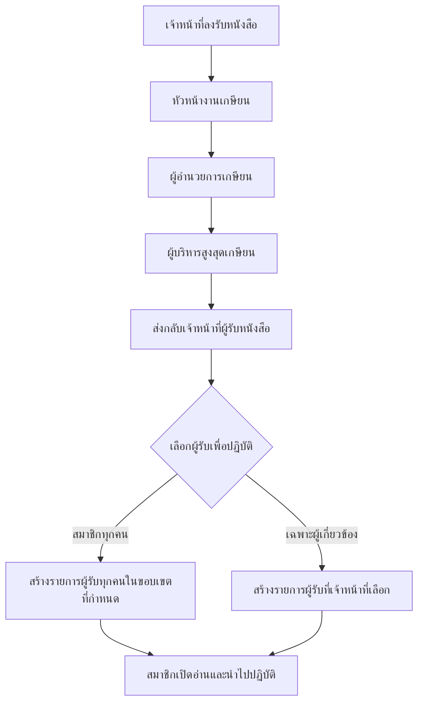

> สถานะเอกสาร ณ 15 พฤศจิกายน 2026: เนื้อหาด้านล่างเป็นข้อกำหนดและแผนออกแบบย้อนหลังของระบบเดิม ปัจจุบันใช้ Node.js/Express/TypeScript + Vue 3 วิธีติดตั้งและสถานะการใช้งานให้อ้างอิง [README.md](README.md), [DEPLOYMENT_GUIDE.md](DEPLOYMENT_GUIDE.md) และ [BACKUP_GUIDE.md](BACKUP_GUIDE.md) ข้อเสนอในเอกสารนี้ไม่ได้หมายความว่าพัฒนาและตรวจรับครบแล้ว
# กระบวนการเกษียนหนังสือและแจกจ่ายเพื่อปฏิบัติ

วันที่ปรับปรุง: 20 ตุลาคม 2026  
เอกสารประกอบ: [โครงสร้างโปรแกรม](./PROGRAM_STRUCTURE.md) และ [แผนพัฒนา](./DEVELOPMENT_PLAN.md)

การตั้งค่ารูปแบบและลำดับผ่านเมนู Admin อ้างอิง [โครงสร้างเมนูผู้ดูแล](./ADMIN_STRUCTURE.md) โดยยังใช้สองเส้นทางที่ยืนยันในเอกสารนี้

## 1. ข้อกำหนดที่ยืนยันจากผู้ใช้งาน

- ผู้มีสิทธิ์เกษียนหนังสือประกอบด้วยหัวหน้างาน ผู้อำนวยการ และผู้บริหารสูงสุด
- หลังลงรับ หนังสือเดินตามลำดับหัวหน้างาน → ผู้อำนวยการ → ผู้บริหารสูงสุด
- บางเรื่องสิ้นสุดการเกษียนที่ผู้อำนวยการ ไม่ต้องผ่านผู้บริหารสูงสุด
- เมื่อครบขั้นตอน หนังสือกลับมาที่เจ้าหน้าที่ผู้รับหนังสือเพื่อดำเนินการแจกจ่าย
- เจ้าหน้าที่เลือกส่งให้สมาชิกทุกคนหรือเฉพาะผู้เกี่ยวข้องเพื่อนำไปปฏิบัติ

การ “เกษียนหนังสือ” ในเอกสารนี้หมายถึงบันทึกความเห็น/ข้อสั่งการตามลำดับผู้รับผิดชอบ ไม่ได้หมายความว่าต้องมีลายเซ็นดิจิทัลหรือเขียนทับไฟล์ PDF โดยอัตโนมัติ

## 2. เส้นทางหนังสือ

### 2.1 เส้นทางถึงผู้บริหารสูงสุด



### 2.2 เส้นทางถึงผู้อำนวยการ

```text
เจ้าหน้าที่ลงรับ → หัวหน้างานเกษียน → ผู้อำนวยการเกษียน
→ กลับเจ้าหน้าที่ผู้รับหนังสือ → แจกจ่ายให้สมาชิกทุกคน/ผู้เกี่ยวข้อง → นำไปปฏิบัติ
```

ให้ระบบมี route template สองแบบ: `TO_DIRECTOR` และ `TO_TOP_EXECUTIVE` โดยไม่สร้างขั้นผู้บริหารสูงสุดในเส้นทางที่จบที่ผู้อำนวยการ การจบเส้นทางสั้นจึงเป็นการเดินครบเส้นทางที่เลือก ไม่ใช่การข้ามขั้น

## 3. บทบาทและสิทธิ์

| บทบาท | งานที่ทำได้ | ข้อจำกัด |
| --- | --- | --- |
| เจ้าหน้าที่ลงรับหนังสือ | ลงรับ เลือกเส้นทาง เสนอหนังสือ รับกลับ และแจกจ่าย | ไม่มีสิทธิ์เกษียนแทนผู้บริหารจากสิทธิ์ลงรับเพียงอย่างเดียว |
| หัวหน้างาน | เกษียนในขั้นหัวหน้างานที่ตนได้รับมอบหมาย | ต้องเป็นขั้นปัจจุบันและอยู่ในขอบเขตที่รับผิดชอบ |
| ผู้อำนวยการ | เกษียนในขั้นผู้อำนวยการ | ต้องผ่านหัวหน้างานก่อน; เมื่อเป็นขั้นสุดท้ายให้ส่งกลับเจ้าหน้าที่ |
| ผู้บริหารสูงสุด | เกษียนในขั้นผู้บริหารสูงสุด | ใช้เฉพาะเส้นทางที่มีขั้นนี้ และต้องผ่านผู้อำนวยการแล้ว |
| สมาชิก/ผู้เกี่ยวข้อง | เปิดอ่านและนำไปปฏิบัติตามรายการที่ได้รับ | เข้าถึงเฉพาะหนังสือ/ไฟล์ที่ได้รับสิทธิ์ |
| ผู้ดูแลระบบ | ตั้งค่าบัญชี บทบาท เส้นทาง และผู้รับผิดชอบ | ไม่ได้สิทธิ์เกษียนหรือเปิดเอกสารทุกฉบับโดยอัตโนมัติ |

Permission ที่เสนอ: `endorsement.submit`, `endorsement.act`, `endorsement.route.manage`, `distribution.create`, `distribution.read`, `distribution.acknowledge` โดยต้องตรวจ role ของขั้น ผู้รับมอบหมาย และขอบเขตเอกสารร่วมกันทุกครั้ง

กรณีผู้ใช้มีหลายบทบาท ระบบต้องแสดงชัดว่ากำลังดำเนินการในบทบาทใด และบันทึกทั้ง user ID และบทบาทของขั้นนั้น ผู้ไม่มีงานในขั้นปัจจุบันไม่สามารถเรียก API เกษียนผ่านการเดา document ID ได้

## 4. การทำงานรายขั้น

1. เจ้าหน้าที่ลงรับและแนบไฟล์ตามข้อกำหนดใน `PROGRAM_STRUCTURE.md`
2. เจ้าหน้าที่เลือกเส้นทางและตรวจรายชื่อหัวหน้างาน ผู้อำนวยการ และผู้บริหารสูงสุดตามเส้นทางก่อนเสนอ ใครเป็นผู้เลือกเส้นทางถือเป็นข้อเสนอเริ่มต้นตามข้อ 11
3. เมื่อกด “เสนอเกษียน” ให้สร้าง workflow instance และสำเนารายการขั้นจาก template ผูกผู้รับผิดชอบแต่ละขั้น แล้วเปิดเฉพาะขั้นแรก
4. ผู้รับขั้นปัจจุบันเปิดหนังสือนำ เอกสารแนบ และความเห็นจากขั้นก่อนหน้า แล้วกรอกความเห็น/ข้อสั่งการ
5. เมื่อกด “ยืนยันเกษียนและส่งต่อ” ให้บันทึกผู้กระทำ บทบาท ข้อความ เวลา และปิดขั้นนั้น จากนั้นเปิดขั้นถัดไป
6. ถ้าครบขั้นตามเส้นทาง ให้ปิดวงรอบเกษียนและสร้างงาน “รอแจกจ่าย” กลับไปที่เจ้าหน้าที่ผู้รับหนังสือเดิม โดยไม่ส่งให้สมาชิกทันที
7. เจ้าหน้าที่เลือก “สมาชิกทุกคน” หรือ “เฉพาะผู้เกี่ยวข้อง” ตรวจรายการผู้รับและข้อความกำกับ แล้วกดแจกจ่าย
8. ระบบสร้างกล่องงานรายผู้รับ ให้เปิดอ่านและนำไปปฏิบัติได้ พร้อมสถานะการอ่านแยกต่อคน

หากเจ้าหน้าที่เดิมไม่สามารถปฏิบัติงานได้ ให้ใช้กระบวนการเปลี่ยนผู้รับผิดชอบที่มีสิทธิ์เฉพาะและบันทึกเหตุผล ไม่เปลี่ยนผู้รับกลับโดยเงียบ ๆ

## 5. สถานะและการเปลี่ยนสถานะ

แยกสถานะการลงรับ การเกษียน และการแจกจ่ายออกจากกัน ไม่บันทึกทุกความหมายลงค่า `st` เดียว

| ส่วน | สถานะตั้งต้นที่เสนอ |
| --- | --- |
| การลงรับ | `DRAFT`, `REGISTERED`, `CANCELLED` ตามเอกสารโครงสร้าง |
| วงรอบเกษียน | `NOT_STARTED`, `IN_PROGRESS`, `COMPLETED` |
| ขั้นเกษียน | `WAITING`, `ACTIVE`, `COMPLETED` |
| การแจกจ่าย | `NOT_READY`, `READY`, `DISTRIBUTED` |
| ผู้รับรายคน | `UNREAD`, `READ`, `ACKNOWLEDGED` โดยการรับทราบเป็นข้อเสนอ |

| เหตุการณ์ | เงื่อนไขก่อนดำเนินการ | ผลลัพธ์ |
| --- | --- | --- |
| เสนอเกษียน | ลงรับแล้ว ยังไม่เริ่ม workflow และผู้รับครบตามเส้นทาง | workflow เป็น `IN_PROGRESS`; ขั้นหัวหน้างานเป็น `ACTIVE` |
| หัวหน้างานยืนยัน | เป็นผู้รับผิดชอบขั้นหัวหน้างานที่ `ACTIVE` | ปิดขั้นหัวหน้างาน เปิดขั้นผู้อำนวยการ |
| ผู้อำนวยการยืนยันในเส้นทางสั้น | เป็นขั้น `ACTIVE` และ route เป็น `TO_DIRECTOR` | workflow เป็น `COMPLETED`; distribution เป็น `READY`; สร้างงานกลับเจ้าหน้าที่ |
| ผู้อำนวยการยืนยันในเส้นทางเต็ม | เป็นขั้น `ACTIVE` และ route เป็น `TO_TOP_EXECUTIVE` | ปิดขั้นผู้อำนวยการ เปิดขั้นผู้บริหารสูงสุด |
| ผู้บริหารสูงสุดยืนยัน | เป็นขั้น `ACTIVE` ของเส้นทางเต็ม | workflow เป็น `COMPLETED`; distribution เป็น `READY`; สร้างงานกลับเจ้าหน้าที่ |
| เจ้าหน้าที่แจกจ่าย | workflow เสร็จครบ ได้รับงานกลับ และมีผู้รับที่อนุญาตอย่างน้อย 1 คน | distribution เป็น `DISTRIBUTED`; สร้างรายการผู้รับ |

ชื่อสถานะเป็นแบบออกแบบใหม่ ต้อง map กับข้อมูล `doc_manage.st`/`docz.st` เดิมก่อนใช้จริง การเกษียนครบไม่เท่ากับสมาชิกปฏิบัติงานเสร็จ และการเปิดอ่านไม่ถือว่าปฏิบัติงานสำเร็จ

## 6. กติกาการแจกจ่าย

- แจกจ่ายได้หลังเกษียนครบตามเส้นทางและหนังสือกลับมาอยู่ในงานเจ้าหน้าที่แล้วเท่านั้น
- “สมาชิกทุกคน” ต้องมีขอบเขตที่นิยามชัด เช่น ทั้งองค์กรหรือเฉพาะหน่วยงาน และต้องไม่ขยายเกินขอบเขตที่เจ้าหน้าที่มีสิทธิ์แจกจ่าย
- ตัวเลือกทุกคนแสดงจำนวนและรายชื่อให้ตรวจสอบก่อนยืนยัน โดย server คำนวณรายชื่ออีกครั้งและตรวจความเปลี่ยนแปลงก่อน commit
- เก็บรายชื่อผู้รับเป็น snapshot ณ เวลายืนยัน ผู้สมัครใหม่ภายหลังไม่ถูกเพิ่มเข้าเอกสารย้อนหลังอัตโนมัติ
- “เฉพาะผู้เกี่ยวข้อง” เลือกผู้ใช้ได้หลายคน ตัดรายการซ้ำ และตรวจบัญชีที่ยังใช้งานรวมถึงขอบเขตหน่วยงาน
- แต่ละผู้รับมีเวลาได้รับ เวลาเปิดอ่าน และเวลารับทราบแยกกันตามความสามารถที่ตกลง
- รายชื่อผู้รับเพิ่มสิทธิ์ดูหนังสือและไฟล์ตามกฎที่กำหนด; บทบาทสมาชิกทั่วไปไม่ทำให้เห็นหนังสือทุกฉบับ
- หากต้องแจกจ่ายเพิ่มเติมหลังรอบแรก ให้เป็นรอบใหม่ที่มีประวัติและไม่ล้างสถานะอ่านของผู้รับเดิม กฎเพิ่ม/ถอนผู้รับต้องยืนยันก่อนเปิดใช้

## 7. หน้าจอและโครงสร้างโปรแกรมเพิ่มเติม

| หน้าจอ | ผู้ใช้หลัก | เนื้อหา |
| --- | --- | --- |
| เลือกเส้นทางและเสนอเกษียน | เจ้าหน้าที่ลงรับ | เส้นทางสองแบบ ผู้รับแต่ละขั้น และสรุปก่อนเสนอ |
| หนังสือรอเกษียน | หัวหน้างาน/ผู้อำนวยการ/ผู้บริหารสูงสุด | งานขั้นปัจจุบัน เรื่อง วันที่ เลขรับ และผู้ส่ง |
| รายละเอียดและเกษียน | ผู้รับขั้นปัจจุบัน | PDF เอกสารแนบ ประวัติความเห็น และช่องบันทึกคำสั่ง |
| หนังสือกลับรอแจกจ่าย | เจ้าหน้าที่ลงรับ | หนังสือที่เกษียนครบและรอเลือกผู้รับ |
| แจกจ่ายหนังสือ | เจ้าหน้าที่ลงรับ | ทุกคน/เฉพาะผู้เกี่ยวข้อง รายชื่อผู้รับ และข้อความกำกับ |
| หนังสือของฉัน | สมาชิก/ผู้เกี่ยวข้อง | หนังสือที่ได้รับ สถานะอ่าน และข้อสั่งการที่มีสิทธิ์เห็น |
| ติดตามเส้นทาง | ผู้ได้รับสิทธิ์ของหนังสือ | ขั้นปัจจุบัน ผู้เกษียน เวลา ความเห็น และสถานะการแจกจ่าย |

```text
apps/api/src/Modules/
  Endorsement/
    RouteTemplates/
    WorkflowInstances/
    WorkflowSteps/
    EndorsementRecords/
  Distribution/
    Batches/
    Recipients/
  Inbox/
apps/web/src/views/
  endorsement/
    EndorsementInboxView.vue
    EndorsementDetailView.vue
    SubmitEndorsementView.vue
  distribution/
    DistributionQueueView.vue
    DistributionCreateView.vue
  my-letters/
    MyLettersView.vue
```

## 8. โครงสร้างข้อมูลที่เสนอเพิ่ม

| ตาราง | ข้อมูลสำคัญ |
| --- | --- |
| `endorsement_route_templates` | code, ชื่อเส้นทาง, version, สถานะใช้งาน |
| `endorsement_route_template_steps` | template ID, ลำดับ, รหัสบทบาท |
| `endorsement_workflows` | document ID, route snapshot/version, สถานะ, current step ID, เจ้าหน้าที่ผู้รับกลับ, ผู้เสนอ, เวลาเริ่ม/จบ, version |
| `endorsement_steps` | workflow ID, ลำดับ, บทบาท, assigned user ID, สถานะ, เวลาเปิด/เสร็จ |
| `endorsement_records` | step ID, ข้อความเกษียน, ผู้กระทำ, บทบาทขณะทำรายการ, เวลา, request ID |
| `distribution_batches` | document ID, workflow ID, โหมดผู้รับ, ขอบเขต, ข้อความกำกับ, ผู้แจกจ่าย, เวลา |
| `distribution_recipients` | batch ID, user ID, เวลาได้รับ/อ่าน/รับทราบ พร้อม unique ต่อ batch/user |

ความสัมพันธ์หลัก: หนังสือ → วงรอบเกษียน → ขั้นตามลำดับ → บันทึกเกษียน; เมื่อครบขั้นจึงเชื่อมไปยังรอบแจกจ่าย → ผู้รับหลายคน

ใช้ `doc_manage`, `doc_profile`, `doc_profile_sub`, `role` และ `role_power` เป็นแหล่งตรวจ mapping ระบบเดิมก่อนเลือก reuse หรือย้ายเข้าส่วนใหม่ ห้ามถือว่าชื่อตารางเดิมยืนยันกฎ workflow นี้ครบแล้ว ส่วน `doc_user_read` ต้องเลือกแหล่งสถานะการอ่านที่เป็นหลักเพียงแห่งเดียว หรือกำหนด adapter ที่ชัดเจน ไม่เขียนซ้ำสองชุดอย่างอิสระ

## 9. API และความสอดคล้องของข้อมูล

| Method | Endpoint | หน้าที่ |
| --- | --- | --- |
| GET | `/api/v1/endorsement-routes` | รายการเส้นทางที่ผู้เสนอเลือกได้ |
| POST | `/api/v1/incoming-letters/:id/endorsement` | เริ่มวงรอบจากเส้นทางและผู้รับที่ตรวจแล้ว |
| GET | `/api/v1/endorsement-inbox` | งานขั้นปัจจุบันของผู้ใช้ |
| GET | `/api/v1/incoming-letters/:id/endorsement` | ลำดับและประวัติเกษียนตามสิทธิ์ |
| POST | `/api/v1/endorsement-steps/:id/complete` | บันทึกความเห็นและส่งต่อ/จบวงรอบ |
| GET | `/api/v1/distribution-queue` | งานกลับรอแจกจ่ายของเจ้าหน้าที่ |
| POST | `/api/v1/incoming-letters/:id/distributions/preview` | ตรวจขอบเขตและแสดง snapshot ผู้รับก่อนแจกจ่าย |
| POST | `/api/v1/incoming-letters/:id/distributions` | ยืนยันรอบแจกจ่ายจาก snapshot ที่ server ตรวจแล้ว |
| GET | `/api/v1/my-letters` | หนังสือที่ตนได้รับ |
| PUT | `/api/v1/distribution-recipients/:id/read-state` | อัปเดตการอ่านของตนเอง |

- การเกษียนใช้ transaction ล็อก workflow/step ตรวจ version และสถานะ `ACTIVE` แล้วบันทึกความเห็น ปิดขั้น และเปิดขั้นใหม่หรือสร้างงานกลับเจ้าหน้าที่ใน transaction เดียว
- ใช้ idempotency key และข้อบังคับไม่ให้ปิดขั้นเดิมซ้ำ การกดยืนยันซ้ำหรือมีสองหน้าจอเปิดพร้อมกันต้องไม่เกิดสองขั้นถัดไปหรือสองงานกลับ
- ตรวจ invariant ว่าหนึ่งวงรอบมีขั้น `ACTIVE` ได้ไม่เกินหนึ่งขั้น และหนึ่งหนังสือเริ่มวงรอบทำงานซ้ำไม่ได้ในรุ่นแรก
- การแจกจ่ายบันทึก batch และ recipients ใน transaction เดียว พร้อม idempotency key ป้องกันสร้างรอบซ้ำจาก retry
- ไม่ให้แก้ template แล้วเปลี่ยนเส้นทางของหนังสือที่เริ่มเดินงานไปแล้ว; ใช้ snapshot ของลำดับและผู้รับ
- เสนอให้ล็อกข้อมูลหลักและชุดไฟล์ที่เสนอระหว่างเกษียน เพื่อให้ทุกขั้นพิจารณาชุดเดียวกัน หากต้องเปลี่ยนสาระสำคัญให้ใช้กฎถอน/เสนอใหม่ที่ต้องยืนยันแยก
- บันทึกเกษียนที่ยืนยันแล้วไม่ให้แก้ทับหรือลบประวัติ การแก้ความเห็นต้องกำหนดเป็นบันทึกเพิ่มเติมตามสิทธิ์ที่ตกลง

## 10. เกณฑ์ทดสอบและตรวจรับ

1. เส้นทางเต็มเดินหัวหน้างาน → ผู้อำนวยการ → ผู้บริหารสูงสุดครบตามลำดับ แล้วกลับเจ้าหน้าที่เดิม
2. เส้นทางสั้นกลับเจ้าหน้าที่หลังผู้อำนวยการ โดยไม่เกิดงานผู้บริหารสูงสุด
3. ผู้ไม่มีสิทธิ์ ผู้ที่ไม่ใช่ผู้รับขั้น หรือผู้รับขั้นอนาคตยืนยันเกษียนไม่ได้
4. เก็บข้อความ ผู้กระทำ บทบาท และเวลาของแต่ละขั้นครบ ตรวจย้อนหลังได้
5. กดยืนยันซ้ำ/ทำรายการพร้อมกันไม่เกิดบันทึกซ้ำ ข้ามขั้น หรืองานกลับซ้ำ
6. หนังสือที่เกษียนยังไม่ครบแจกจ่ายไม่ได้ และการเกษียนครบยังไม่ส่งให้สมาชิกอัตโนมัติ
7. แจกจ่ายแบบทุกคนได้เฉพาะ snapshot บัญชีที่ใช้งานในขอบเขตที่อนุญาต ไม่มีสมาชิกนอกขอบเขตหลุดเข้าไป
8. แจกจ่ายเฉพาะผู้เกี่ยวข้องสร้างผู้รับครบ ไม่ซ้ำ และสมาชิกอื่นเข้าถึงหนังสือ/ไฟล์ไม่ได้
9. สถานะการอ่านแยกแต่ละคน ผู้ใช้แก้สถานะการอ่านของผู้อื่นไม่ได้
10. transaction ล้มเหลวไม่ทิ้งขั้น/ผู้รับบางส่วน และ retry คืนผลเดิมได้
11. การเปลี่ยน template หรือการเพิ่มสมาชิกภายหลังไม่เปลี่ยนรายการขั้น/ผู้รับของหนังสือที่ยืนยันแล้ว
12. หากผู้รับกลับหรือผู้เกษียนถูกปิดบัญชี หนังสือต้องแสดงปัญหาและรอการมอบหมายใหม่ตามสิทธิ์ ไม่ข้ามขั้นหรือเปลี่ยนคนโดยอัตโนมัติ

## 11. รายละเอียดที่ยังต้องกำหนด

ข้อกำหนดหลักในข้อ 1 ยืนยันแล้ว ส่วนต่อไปนี้ยังเป็นการออกแบบที่ต้องสรุปเพิ่มเติม:

- ใครเลือกเส้นทางถึงผู้อำนวยการหรือผู้บริหารสูงสุด: ข้อเสนอเริ่มต้นคือเจ้าหน้าที่ผู้เสนอเลือกก่อนเริ่ม
- หัวหน้างาน/ผู้บริหารที่มีหลายคนให้เลือกจากทะเบียน หน่วยงาน หรือกฎใด; ไม่เลือกจากชื่อบทบาทอย่างเดียว
- สมาชิกทุกคนหมายถึงทั้งองค์กรหรือเฉพาะหน่วยงานใด และรวมผู้เสนอ/ผู้เกษียนด้วยหรือไม่
- ความเห็นเกษียนเป็นข้อความในระบบเพียงอย่างเดียว หรือต้องมีตำแหน่งลงนาม/ภาพลายเซ็นบน PDF ด้วย
- อนุญาตส่งคืนแก้ไข ถอนเรื่อง เปลี่ยนเส้นทางหลังเสนอ หรือมอบอำนาจแทนหรือไม่; ยังไม่สร้าง transition เหล่านี้โดยสมมติ
- ผู้รับต้องเพียงเปิดอ่าน รับทราบ หรือรายงานผลการปฏิบัติและให้ใครตรวจปิดงาน; ข้อกำหนดปัจจุบันยังไม่กำหนดการปิดงานรายคน
- สมาชิกเห็นความเห็นทุกขั้นหรือเฉพาะข้อสั่งการที่อนุญาต และหนังสือที่มีข้อจำกัดการเผยแพร่แจกจ่ายอย่างไร

เอกสารนี้เป็นข้อกำหนดและโครงสร้างสำหรับพัฒนาต่อ ยังไม่ได้สร้างแอปพลิเคชันหรือเปลี่ยนฐานข้อมูลจริง


ปรับปรุงด้านเทคโนโลยี 27 ตุลาคม 2026: backend เป้าหมายเป็น PHP 8.2.35 / Composer ตาม แผนตรวจความพร้อม (เอกสารเดิม ไม่ได้รวมอยู่ในชุดปัจจุบัน; ใช้ README สำหรับการติดตั้งปัจจุบัน); คงกฎสิทธิ์และ workflow ตามเอกสารนี้
