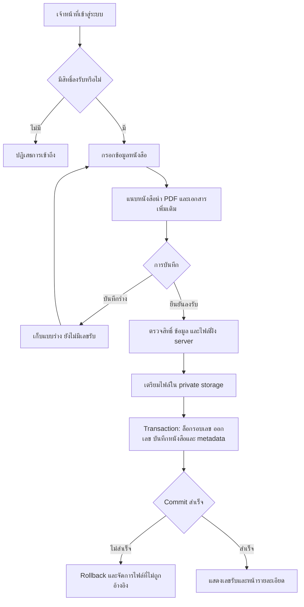

> สถานะเอกสาร ณ 15 พฤศจิกายน 2026: เนื้อหาด้านล่างเป็นข้อกำหนดและแผนออกแบบย้อนหลังของระบบเดิม ปัจจุบันใช้ Node.js/Express/TypeScript + Vue 3 วิธีติดตั้งและสถานะการใช้งานให้อ้างอิง [README.md](README.md), [DEPLOYMENT_GUIDE.md](DEPLOYMENT_GUIDE.md) และ [BACKUP_GUIDE.md](BACKUP_GUIDE.md) ข้อเสนอในเอกสารนี้ไม่ได้หมายความว่าพัฒนาและตรวจรับครบแล้ว
# โครงสร้างโปรแกรม DOCZ: ระบบลงรับหนังสือ

วันที่: 20 ตุลาคม 2026; ปรับปรุงเป้าหมาย runtime: 27 ตุลาคม 2026  
Backend เป้าหมาย: PHP 8.2.35 / Composer (เลือก framework หลังสำรวจ source เดิม)  
Frontend: Vue.js 3 / TypeScript  
เอกสารประกอบ: [แผนพัฒนาระบบ](./DEVELOPMENT_PLAN.md)

ข้อกำหนดเพิ่มเติมที่ยืนยันแล้ว: [กระบวนการเกษียนหนังสือและแจกจ่ายเพื่อปฏิบัติ](./ENDORSEMENT_WORKFLOW.md) ให้ใช้เส้นทางและสิทธิ์ในเอกสารนี้แทนส่วนที่เคยระบุว่ารอรายละเอียด workflow

เมนูผู้ดูแลตามภาพเพิ่มเติม: [โครงสร้าง Admin](./ADMIN_STRUCTURE.md) ประกอบด้วย User, กำหนดสิทธิ์, กำหนดขั้นตอน และกำหนดแฟ้มเอกสาร

## 1. ข้อกำหนดที่ได้รับ

1. มีงานลงรับหนังสือสำหรับผู้ได้รับสิทธิ์เจ้าหน้าที่ลงรับหนังสือ
2. ระบบรันเลขรับหนังสือ
3. แนบหนังสือนำเป็นไฟล์ PDF
4. แนบเอกสารเพิ่มเติมได้หลายไฟล์ รองรับ PDF, Word, Excel และไฟล์ภาพ
5. เปลี่ยนเป้าหมาย backend เป็น PHP 8.2.35 ตามคำขอวันที่ 27 ตุลาคม 2026 และคง Vue.js เป็น frontend
6. หลังลงรับ เสนอเกษียนตามลำดับหัวหน้างาน → ผู้อำนวยการ → ผู้บริหารสูงสุด หรือสิ้นสุดที่ผู้อำนวยการตามเรื่อง
7. เมื่อเกษียนครบ ส่งกลับเจ้าหน้าที่ผู้รับหนังสือเพื่อแจกจ่ายให้สมาชิกทุกคนหรือเฉพาะผู้เกี่ยวข้องนำไปปฏิบัติ

ภาพหน้าจอที่ให้มาใช้เป็นตัวอย่างระบบเดิม พบเมนูระบบเอกสาร อยู่ระหว่างดำเนินการ หนังสือนอกแฟ้ม แฟ้มเอกสาร เอกสารทั้งหมด ค้นหาหนังสือ และหนังสือของฉัน รวมทั้งส่วนเมนูตามบทบาท ภาพยังไม่แสดงรายละเอียดแบบฟอร์มลงรับ จึงใช้เป็นข้อมูลประกอบโครงสร้างเมนูเท่านั้น ไม่ถือว่ารายการและจำนวนบนภาพเป็นข้อกำหนดของระบบใหม่ทั้งหมด

## 2. ขอบเขตและสมมติฐานตั้งต้น

| ประเด็น | แบบตั้งต้นเพื่อใช้พัฒนา | สถานะ |
| --- | --- | --- |
| หนังสือนำ | PDF หลัก 1 ไฟล์ต่อหนังสือ และต้องมีเมื่อยืนยันลงรับ | ข้อเสนอ ต้องยืนยันจำนวนและการบังคับแนบ |
| เอกสารเพิ่มเติม | 0 ถึงหลายไฟล์ ต่างชนิดกันในรายการเดียวได้ | รองรับหลายไฟล์ตามที่ร้องขอ; การไม่บังคับแนบเป็นข้อเสนอ |
| การออกเลข | ออกเลขเมื่อกดยืนยันลงรับสำเร็จ ไม่ออกเมื่อเปิดฟอร์มหรือบันทึกร่าง | ข้อเสนอ |
| รอบเลขรับ | แยกตามปีทะเบียนและทะเบียนรับ | ข้อเสนอ ต้องยืนยันรอบปีและขอบเขตทะเบียน |
| วันที่ย้อนหลัง | เลือกวันที่รับได้ตามสิทธิ์ แต่ปีของเลขรับใช้ปีทะเบียนที่ยืนยันโดย server | ข้อเสนอ ต้องกำหนดกฎย้อนหลัง |
| ผู้ดูแลระบบ | ดูแลบัญชีและสิทธิ์; จะลงรับได้เมื่อได้รับสิทธิ์ลงรับด้วย | ข้อเสนอ |
| เกษียนและแจกจ่าย | สองเส้นทางตาม `ENDORSEMENT_WORKFLOW.md` แล้วส่งกลับเจ้าหน้าที่เพื่อแจกจ่าย | ยืนยันลำดับหลักแล้ว; รายละเอียดปลีกย่อยระบุแยกในเอกสาร |
| แฟ้มเอกสาร | วางจุดเชื่อมไว้ | ยังไม่ได้รับรายละเอียดการทำงาน |

ค่าที่เสนอในเอกสารนี้ใช้เป็นค่าเริ่มต้นในการหารือ ต้องสรุปก่อนเขียน business rules ที่เกี่ยวข้อง ไม่ตีความเป็นกฎเดิมของฐานข้อมูลโดยอัตโนมัติ

## 3. โมดูลโปรแกรม

| โมดูล | หน้าที่ |
| --- | --- |
| Authentication | เข้าสู่ระบบ ออกจากระบบ และตรวจ session |
| Authorization | ตรวจสิทธิ์ลงรับ ดู แก้ไข ยกเลิก และเข้าถึงไฟล์ |
| Incoming Letters | ฟอร์มลงรับ บันทึกร่าง ยืนยันลงรับ ค้นหา และรายละเอียดหนังสือ |
| Receive Numbering | จัดการรอบทะเบียนและรันเลขรับ ป้องกันเลขซ้ำเมื่อใช้งานพร้อมกัน |
| Document Files | หนังสือนำ PDF และเอกสารแนบหลายไฟล์ ตรวจไฟล์และจัดเก็บแบบ private |
| Master Data | ทะเบียนรับ ประเภทหนังสือ ความเร่งด่วน หน่วยงาน และหมวดหมู่ตามที่ยืนยัน |
| Audit | ประวัติลงรับ แก้ไข ยกเลิก เพิ่ม/แทนที่ไฟล์ และผู้ดำเนินการ |
| Endorsement | เกษียนตามเส้นทางผ่านหัวหน้างาน ผู้อำนวยการ และผู้บริหารสูงสุดตามเรื่อง |
| Distribution | รับหนังสือกลับหลังเกษียน แล้วแจกจ่ายให้สมาชิกทุกคนหรือเฉพาะผู้เกี่ยวข้อง |

## 4. เมนูและหน้าจอ Vue.js

```text
เข้าสู่ระบบ
หน้าหลัก
ระบบหนังสือ
  ทะเบียนหนังสือรับ
    รายการหนังสือรับ
    ลงรับหนังสือใหม่
    แบบร่างของฉัน
    รายละเอียดหนังสือ
  ค้นหาหนังสือ
  หนังสือรอเกษียน             [หัวหน้างาน/ผู้อำนวยการ/ผู้บริหารสูงสุด]
  หนังสือกลับรอแจกจ่าย        [เจ้าหน้าที่ผู้รับหนังสือ]
  หนังสือของฉัน              [สมาชิก/ผู้เกี่ยวข้องที่ได้รับแจกจ่าย]
  อยู่ระหว่างดำเนินการ       [ติดตามขั้นปัจจุบันตามสิทธิ์]
  หนังสือนอกแฟ้ม/แฟ้มเอกสาร  [ระยะต่อไป ต้องนิยามความหมาย]
Admin                         [เมนูยืนยันจากภาพ]
  User
  กำหนดสิทธิ์
  กำหนดขั้นตอน
  กำหนดแฟ้มเอกสาร
ตั้งค่าเพิ่มเติม                [ข้อเสนอสำหรับระบบใหม่]
  ทะเบียนรับและรอบเลข
  ข้อมูลกลาง
  ประวัติการใช้งาน
```

### 4.1 หน้ารายการหนังสือรับ

- ตัวกรอง: ปีทะเบียน เลขรับ วันที่รับ เลขที่หนังสือ เรื่อง หน่วยงานต้นทาง และสถานะ
- ตาราง: เลขรับ วันที่รับ เลขที่หนังสือ เรื่อง ต้นทาง หนังสือนำ จำนวนเอกสารแนบ ผู้ลงรับ และสถานะ
- แบ่งหน้าและเรียงลำดับผ่าน API ไม่โหลดหนังสือทั้งหมดมาที่ browser
- ปุ่ม “ลงรับหนังสือใหม่” แสดงตามสิทธิ์ และ API ตรวจสิทธิ์ซ้ำเสมอ
- เปิดรายละเอียด ดาวน์โหลดหนังสือนำ และดูรายการเอกสารแนบตามขอบเขตการเข้าถึง

### 4.2 แบบฟอร์มลงรับหนังสือ

| กลุ่ม | ช่องข้อมูล | กติกาที่เสนอ |
| --- | --- | --- |
| ทะเบียน | ทะเบียนรับ / ปีทะเบียน | server ตรวจว่าเปิดใช้งานและผู้ใช้มีสิทธิ์ |
| เลขรับ | เลขรับหนังสือ | อ่านอย่างเดียว แสดง “ระบบออกเลขเมื่อยืนยันลงรับ” ก่อนบันทึกจริง |
| วันที่ | วันที่และเวลารับ | บังคับ มีค่าเริ่มต้นจากเวลา server และแสดง Asia/Bangkok |
| ข้อมูลหนังสือ | เลขที่หนังสือ / วันที่หนังสือ | แยกจากเลขรับและวันที่รับ; รองรับกรณีไม่มีเลขตามกฎที่ยืนยัน |
| เนื้อหา | เรื่อง | บังคับ ไม่เกิน 1,000 ตัวอักษรตาม schema เดิม |
| หน่วยงาน | จาก / ถึง | บังคับตามกฎที่ยืนยัน; ต้องตรวจความหมาย `doc_form` เดิมก่อน map |
| การจำแนก | ความเร่งด่วน / หมวดหมู่ | เลือกจากข้อมูลกลางและใช้ค่าที่ตกลงกับระบบเดิม |
| หนังสือนำ | เลือก PDF | แสดงชื่อ ขนาด และปุ่มเปิดตัวอย่าง |
| เอกสารเพิ่มเติม | เลือก/ลากวางหลายไฟล์ | เพิ่ม ลบ และเรียงไฟล์ก่อนยืนยันได้ |
| หมายเหตุ | ข้อความเพิ่มเติม | เป็นช่องใหม่ที่เสนอ ต้องเพิ่ม schema หากยืนยันใช้ |

ปุ่มท้ายฟอร์ม: “บันทึกร่าง”, “ยืนยันลงรับ” และ “กลับหน้ารายการ” ก่อนออกจากหน้าที่มีการแก้ไขแต่ยังไม่บันทึกให้แจ้งเตือนข้อมูลค้าง

### 4.3 หน้ารายละเอียด

- ส่วนหัว: เลขรับ วันที่รับ เรื่อง และสถานะ
- ส่วนข้อมูลหนังสือ: เลขที่หนังสือ วันที่หนังสือ จาก ถึง และหมวดหมู่
- ส่วนหนังสือนำ: PDF viewer และดาวน์โหลดผ่าน API ที่ตรวจสิทธิ์
- ส่วนเอกสารแนบ: ลำดับ ชื่อเดิม ประเภท ขนาด ผู้เพิ่ม เวลาเพิ่ม และดาวน์โหลด
- ส่วนประวัติ: ผู้ลงรับ การแก้ไข การแทนที่ไฟล์ และเหตุผลยกเลิก

## 5. ลำดับการลงรับหนังสือ



สถานะการลงทะเบียนที่เสนอคือ `DRAFT`, `REGISTERED`, `CANCELLED` ซึ่งแยกจากสถานะดำเนินงาน/ส่งต่อ ห้ามนำชื่อหรือค่าเหล่านี้ไปแทน `docz.st` จนกว่าจะทำ mapping สถานะเดิมแล้ว

## 6. กติกาการรันเลขรับ

1. Server เป็นผู้ออกเลข ผู้ใช้แก้เลขรับจาก browser ไม่ได้
2. ตัวอย่างรูปแบบเพื่อหารือ: `000123/2569` โดยเก็บปี ลำดับ และทะเบียนรับแยกกัน ไม่เก็บเฉพาะข้อความที่จัดรูปแบบแล้ว
3. ต้องยืนยันว่าใช้ปีปฏิทินหรือปีงบประมาณ แสดง พ.ศ. หรือ ค.ศ. เริ่มที่เลขใด และแต่ละหน่วยงานใช้ทะเบียนร่วมกันหรือไม่
4. ใช้ตารางลำดับเลขที่มี unique `(register_id, numbering_year)` และล็อกแถวด้วย transaction เช่น `SELECT ... FOR UPDATE` ก่อนเพิ่มเลข
5. การสร้างแถวรอบปีครั้งแรกต้องรองรับการแข่งขันด้วย unique constraint และ retry ที่จำกัด หรือเตรียมรอบปีไว้ล่วงหน้า
6. บันทึกเลขลำดับ หนังสือ metadata ไฟล์ และประวัติลงรับใน transaction เดียวกัน พร้อม unique `(register_id, numbering_year, receive_sequence)` เป็นด่านสุดท้าย
7. ใช้ idempotency key สำหรับยืนยันลงรับ ผูกกับผู้ใช้และ payload; คำขอเดิมที่ส่งซ้ำต้องคืนหนังสือและเลขเดิม ส่วน key เดิมแต่ payload ต่างกันให้ปฏิเสธ
8. หาก transaction ล้มเหลวก่อน commit ให้ rollback ทั้งหนังสือและการเพิ่มเลข หาก server commit แล้วแต่ browser ไม่ได้รับผล ให้ตรวจด้วย idempotency key แทนการออกเลขใหม่
9. หนังสือที่ลงรับแล้วและยกเลิกต้องเก็บเลขเดิมกับเหตุผล ห้ามนำเลขนั้นกลับมาใช้
10. ก่อนเปิดใช้กับข้อมูลเดิม ต้องตรวจเลขที่ใช้จริงและเริ่ม counter ให้พ้นเลขเดิมในแต่ละรอบ ไม่ตั้งเริ่มที่ 1 ทับข้อมูลเก่า และห้ามใช้ `MAX(r_number) + 1` เป็นวิธีออกเลขประจำวัน

## 7. หนังสือนำและเอกสารแนบหลายไฟล์

| กลุ่มไฟล์ | ประเภทที่รองรับตั้งต้น | จำนวน |
| --- | --- | --- |
| หนังสือนำ | `.pdf` | เสนอ 1 ไฟล์ที่ใช้งานอยู่ต่อหนังสือ |
| PDF เพิ่มเติม | `.pdf` | หลายไฟล์ |
| Word | `.doc`, `.docx` | หลายไฟล์ |
| Excel | `.xls`, `.xlsx` | หลายไฟล์ |
| ภาพ | `.jpg`, `.jpeg`, `.png`, `.webp` | หลายไฟล์; ชนิดภาพอื่นต้องตกลงเพิ่ม |

ข้อกำหนดการจัดการไฟล์:

- ตรวจ extension, MIME type และโครงสร้างไฟล์ที่ตรวจได้ ไม่เชื่อเฉพาะค่าที่ browser ส่งมา; เอกสาร Office รุ่นเก่าต้องตรวจรูปแบบภายในตามชนิดจริง
- ไม่เปิดรับไฟล์ macro-enabled หรือ active content เพิ่มโดยอัตโนมัติ; หากต้องใช้ให้กำหนดนโยบายแยก
- ค่าเริ่มต้นเพื่อประเมิน: สูงสุด 20 MB ต่อไฟล์, เอกสารเพิ่มเติม 20 ไฟล์ และรวม 100 MB ต่อหนังสือ ปรับได้จาก config หลังยืนยันความต้องการและข้อจำกัด infrastructure
- ตรวจยอดรวมทั้งไฟล์เดิมและไฟล์ใหม่ ตั้ง upload limit ที่ proxy/API ให้สอดคล้องกัน
- แต่ละไฟล์มี UUID ชื่อเดิม storage key ประเภท ขนาด checksum ผู้เพิ่ม และเวลาเพิ่ม
- เก็บไฟล์นอก public directory ใช้ API ตรวจสิทธิ์ก่อนเปิด/ดาวน์โหลดทุกครั้ง
- PDF/ภาพเปิดตัวอย่างได้; Word/Excel ดาวน์โหลดไปเปิดด้วยโปรแกรมที่รองรับ ไม่รับปากแสดง Office ใน browser ในรุ่นแรก
- เตรียมไฟล์ใน storage ให้ครบก่อน commit metadata เพื่อไม่ถือ transaction ของเลขรับระหว่างอัปโหลด; หากบันทึกไม่สำเร็จมี cleanup/reconciliation สำหรับไฟล์ที่ไม่ถูกอ้างอิง
- temporary upload token ต้องผูกกับเจ้าของและหมดอายุได้ ป้องกันการนำ token ของผู้อื่นมาแนบ และย้ายสถานะไฟล์ได้เพียงครั้งเดียว
- หลังลงรับแล้ว การเปลี่ยนหนังสือนำหรือถอดเอกสารแนบต้องตรวจสิทธิ์และบันทึกประวัติ เสนอเก็บเวอร์ชันเดิมแทนการเขียนทับไฟล์

## 8. โครงสร้างข้อมูลและการเชื่อมฐานข้อมูลเดิม

### 8.1 ตารางเดิมที่เกี่ยวข้อง

| ตาราง/คอลัมน์เดิม | การใช้งานที่เสนอ | ข้อควรตรวจสอบ |
| --- | --- | --- |
| `docz.r_number`, `r_date` | เลขรับและวันที่รับ | รูปแบบ/รอบเลขเดิมและเลขซ้ำ |
| `docz.doc_form_number`, `doc_date`, `name` | เลขที่หนังสือ วันที่หนังสือ เรื่อง | กฎข้อมูลว่างและรูปแบบวันที่ |
| `docz.doc_form`, `doc_to`, `doc_speed` | จาก/ถึง/ความเร่งด่วนหลังยืนยัน mapping | `doc_form` ยังไม่ยืนยันความหมาย |
| `docz.file` | แหล่งไฟล์เดิมที่ต้องสำรวจ | ยังไม่ยืนยันว่าเป็นหนังสือนำ |
| `doc_file.docz_id`, `name`, `file`, `ext` | ความสัมพันธ์และ metadata ไฟล์แนบเดิม | ยังไม่มีขนาด/MIME/ประเภทหนังสือนำใน schema ที่ตรวจพบ |
| `doc_cat`, `doc_cat_name` | หมวดหมู่หนังสือ | ตรวจความสัมพันธ์และรายการซ้ำ |
| `user`, `role`, `role_name`, `role_power` | บัญชีและ mapping สิทธิ์ | ไม่ใช้เพียงชื่อบทบาทมาตัดสินสิทธิ์ |

### 8.2 ส่วนขยายที่เสนอ

ชื่อตาราง/คอลัมน์ต่อไปนี้เป็นแบบออกแบบใหม่ ยังไม่ได้สร้างจริง:

| ส่วนขยาย | ข้อมูลหลัก |
| --- | --- |
| `receive_registers` | รหัสทะเบียน ชื่อ สถานะเปิดใช้ และขอบเขตหน่วยงาน |
| `receive_number_sequences` | `register_id`, `numbering_year`, `last_number`, `updated_at` พร้อม unique ต่อทะเบียน/ปี |
| เพิ่มข้อมูลลงทะเบียนใน `docz` | `register_id`, `numbering_year`, `receive_sequence`, `registration_status`, `registered_at`, `registered_by`, `version` |
| `document_assets` | `id`, `document_id`, `kind` (`MAIN`/`ATTACHMENT`), `original_name`, `storage_key`, `mime_type`, `size_bytes`, `checksum`, `sort_order`, `version`, `created_by`, `created_at`, `removed_at` |
| `docz.main_asset_id` | ตัวชี้หนังสือนำปัจจุบันหนึ่งไฟล์; ตรวจว่า asset เป็นของหนังสือเดียวกันภายใน transaction |
| `upload_sessions` | token/เจ้าของ upload, storage key, ผลตรวจไฟล์, วันหมดอายุ และสถานะผูกเอกสาร |
| `idempotency_requests` | ผู้ใช้ key, request hash, สถานะ และ document ID ที่สร้างสำเร็จ |
| `audit_logs` | ผู้กระทำ หนังสือ การกระทำ เวลา request ID และรายละเอียดที่ไม่ใช่ความลับ |

แบบร่างยังไม่มีเลข จึงให้คอลัมน์เลขลำดับใหม่เป็น NULL ได้ unique constraint ต้องมีผลกับรายการที่มีเลขแล้ว และต้องออกแบบข้อมูลเริ่มต้นของคอลัมน์เดิม `r_number` ที่เป็น NOT NULL อย่างชัดเจน ห้ามใส่เลขปลอมเพื่อหลบ validation

แนวทางตั้งต้นสำหรับไฟล์คือใช้ `document_assets` เป็น metadata ของระบบใหม่ และอ่านไฟล์เก่าผ่าน legacy adapter ไม่เขียนซ้ำทั้ง `doc_file` และ `document_assets` โดยไม่มีแผนความสอดคล้อง ต้องสรุปการแปลงไฟล์เดิมและ `main_asset_id` จาก manifest ก่อนเปิดใช้; ไม่เปิดสองระบบเขียนข้อมูลเดียวกันพร้อมกันในระยะเปลี่ยนผ่าน

การเพิ่มคอลัมน์ที่บังคับและ unique indexes ต้อง backfill และตรวจข้อมูลเก่าก่อนเสมอ ใช้ migration ที่ตรวจทานและปิด ORM schema synchronization

## 9. โครงสร้าง source code

โครงสร้าง PHP เชิงแนวคิด ใช้ Composer / PSR-4; framework และรูปแบบ directory จริงสรุปหลังสำรวจ source เดิม ดู ผลตรวจ PHP 8.2.35 (เอกสารเดิม ไม่ได้รวมอยู่ในชุดปัจจุบัน; ใช้ README สำหรับการติดตั้งปัจจุบัน)

~~~text
apps/api/
  composer.json
  composer.lock
  public/index.php
  src/
    Modules/
      Auth/
      Authorization/
      IncomingLetters/
        DTO/
        IncomingLetterController.php
        IncomingLetterService.php
        IncomingLetterRepository.php
      ReceiveNumbering/
      DocumentFiles/
      MasterData/
      Audit/
    Shared/
      Middleware/
      Validation/
    Infrastructure/
      Database/
      Storage/PrivateStorageAdapter.php
  config/
  routes/
  database/migrations/
  tests/
apps/web/src/
  views/incoming/
    IncomingListView.vue
    IncomingCreateView.vue
    IncomingDetailView.vue
    IncomingDraftListView.vue
  components/incoming/
    IncomingLetterForm.vue
    MainPdfUpload.vue
    MultipleAttachmentsUpload.vue
    AttachmentList.vue
    ReceiveNumberDisplay.vue
  api/
  router/
  stores/
  layouts/
contracts/openapi.yaml
~~~
## 10. API ตั้งต้น

| Method | Endpoint | การทำงาน/สิทธิ์ |
| --- | --- | --- |
| GET | `/api/v1/incoming-letters` | รายการ/ค้นหา เฉพาะขอบเขตที่มีสิทธิ์ดู |
| POST | `/api/v1/incoming-letters/drafts` | สร้างร่าง ยังไม่ออกเลข |
| PATCH | `/api/v1/incoming-letters/:id/draft` | แก้ไขร่างที่เป็นเจ้าของหรือได้รับสิทธิ์ |
| POST | `/api/v1/uploads` | อัปโหลดชั่วคราว ระบุ `MAIN`/`ATTACHMENT` และคืน token |
| DELETE | `/api/v1/uploads/:token` | ลบไฟล์ชั่วคราวของตนเอง |
| POST | `/api/v1/incoming-letters/register` | ยืนยันลงรับจากร่างหรือข้อมูลใหม่พร้อม upload tokens; บังคับ idempotency key |
| GET | `/api/v1/incoming-letters/:id` | ดูรายละเอียดตามสิทธิ์ |
| PATCH | `/api/v1/incoming-letters/:id` | แก้ข้อมูลที่อนุญาตหลังลงรับ ใช้ version ป้องกันทับงานผู้อื่น |
| POST | `/api/v1/incoming-letters/:id/cancel` | ยกเลิกพร้อมเหตุผลและเก็บเลขเดิม |
| POST | `/api/v1/incoming-letters/:id/attachments` | ผูกไฟล์เพิ่มเติมจาก upload tokens หลังลงรับ |
| PUT | `/api/v1/incoming-letters/:id/main-file` | แทนที่หนังสือนำจาก token พร้อมเก็บประวัติ |
| DELETE | `/api/v1/incoming-letters/:id/attachments/:fileId` | ถอดไฟล์แนบตามสิทธิ์ ไม่ลบประวัติ |
| GET | `/api/v1/files/:id/download` | ดาวน์โหลดหลังตรวจสิทธิ์หนังสือและสถานะไฟล์ |
| GET | `/api/v1/files/:id/preview` | เปิดตัวอย่างเฉพาะ PDF/ภาพที่อนุญาต |
| GET | `/api/v1/incoming-letters/:id/history` | ดูประวัติตามสิทธิ์ |

ไม่มี API สำหรับขอเลขล่วงหน้าที่ทำให้ counter เพิ่มโดยยังไม่ลงรับ และไม่เปิดให้แก้เลขรับผ่าน endpoint แก้ไขข้อมูลทั่วไป

## 11. สิทธิ์ที่ต้องกำหนด

| Permission | หน้าที่ | ผู้ได้รับตั้งต้นที่เสนอ |
| --- | --- | --- |
| `incoming.read` | ดู/ค้นหาตามขอบเขตเอกสาร | เจ้าหน้าที่ลงรับ; บทบาทอื่นตามที่กำหนด |
| `incoming.register` | สร้างร่างและยืนยันลงรับ | เจ้าหน้าที่ลงรับหนังสือ |
| `incoming.update` | แก้ข้อมูลหลังลงรับในช่องที่อนุญาต | เจ้าหน้าที่ลงรับตามขอบเขต |
| `incoming.cancel` | ยกเลิกหนังสือ | ผู้ได้รับมอบหมาย ต้องยืนยัน |
| `incoming.files.manage` | เพิ่ม/แทนที่/ถอดไฟล์ | เจ้าหน้าที่ลงรับตามขอบเขต |
| `incoming.files.read` | เปิด/ดาวน์โหลดไฟล์ของเอกสารที่มีสิทธิ์ | ผู้ได้รับสิทธิ์ดูไฟล์ |
| `numbering.manage` | ตั้งค่าทะเบียนและรอบเลข | ผู้ดูแลที่ได้รับมอบหมาย |
| `permissions.manage` | กำหนดผู้ใช้และสิทธิ์ | ผู้ดูแลระบบ |

ทุก permission ต้องตรวจขอบเขตเอกสาร/หน่วยงานประกอบ ห้ามยึดเพียงการซ่อนเมนู Vue เป็นการควบคุมสิทธิ์

## 12. เกณฑ์ตรวจรับฟังก์ชันลงรับ

- เจ้าหน้าที่ที่ได้รับสิทธิ์ลงรับได้ ผู้ไม่มีสิทธิ์ถูกปฏิเสธทั้งหน้าจอและ API
- บันทึกร่างไม่ออกเลข และต้องเติมข้อมูล/หนังสือนำครบตามกฎก่อนยืนยัน
- ลงรับพร้อมกันหลายคำขอได้เลขไม่ซ้ำในทะเบียน/ปีเดียวกัน
- กดซ้ำหรือ retry ด้วย idempotency key เดิมได้หนังสือเดิม ไม่เพิ่ม counter ซ้ำ
- transaction ล้มเหลวไม่เหลือหนังสือครึ่งรายการ และ counter rollback; กรณี commit แล้วแต่ network ขาดตรวจผลเดิมได้
- หนังสือนำรับเฉพาะ PDF และเอกสารเพิ่มเติมแนบ PDF, Word, Excel และภาพหลายไฟล์ในรายการเดียวได้
- ไฟล์ผิดประเภท เกินจำนวน/ขนาด หรือ token ของผู้อื่นถูกปฏิเสธ แม้ข้าม validation หน้าเว็บ
- ผู้ไม่มีสิทธิ์เปิด URL ไฟล์โดยตรงไม่ได้ และไฟล์ไม่ถูกเสิร์ฟจาก public path
- แทนที่หนังสือนำแล้วมีไฟล์หลักปัจจุบันเพียงไฟล์เดียว พร้อมประวัติเวอร์ชันเดิม
- ยกเลิกแล้วเลขรับไม่ถูกนำกลับมาใช้ และค้นประวัติ/เหตุผลได้
- เปิดรอบปีครั้งแรกพร้อมกันไม่เกิด counter ซ้ำ และข้อมูลเก่าไม่ชนเลขใหม่
- ตรวจการตั้งค่าเวลาและปีทะเบียนโดยเฉพาะช่วงข้ามวัน/ข้ามปี และกรณีลงวันที่ย้อนหลัง

## 13. ลำดับพัฒนาส่วนลงรับ

1. ยืนยันรูปแบบเลข รอบปี ขอบเขตทะเบียน สิทธิ์ และกติกาไฟล์จากข้อ 2
2. สำรวจเลขและไฟล์เดิม สร้าง manifest และฐานข้อมูลสำเนา
3. สร้าง auth/authorization และ entity mapping
4. สร้างหน้ารายการ ฟอร์มลงรับ และระบบ upload ชั่วคราว
5. สร้าง transaction ออกเลข/ยืนยันลงรับ และ idempotency
6. เพิ่มรายละเอียด preview/download การแก้ไข ยกเลิก และ audit
7. ทดสอบ concurrency, rollback, สิทธิ์ และไฟล์หลายชนิด แล้วให้เจ้าหน้าที่ทดลองงานจริง
8. พัฒนาเกษียนสองเส้นทาง งานกลับเจ้าหน้าที่ และแจกจ่ายตาม `ENDORSEMENT_WORKFLOW.md`; เก็บรายละเอียดแฟ้มเอกสารแยกต่อไป

เอกสารนี้เป็นโครงสร้างและข้อกำหนดสำหรับพัฒนาต่อ ยังไม่ได้สร้าง source code ของแอปพลิเคชันหรือแก้ไขฐานข้อมูลจริง
